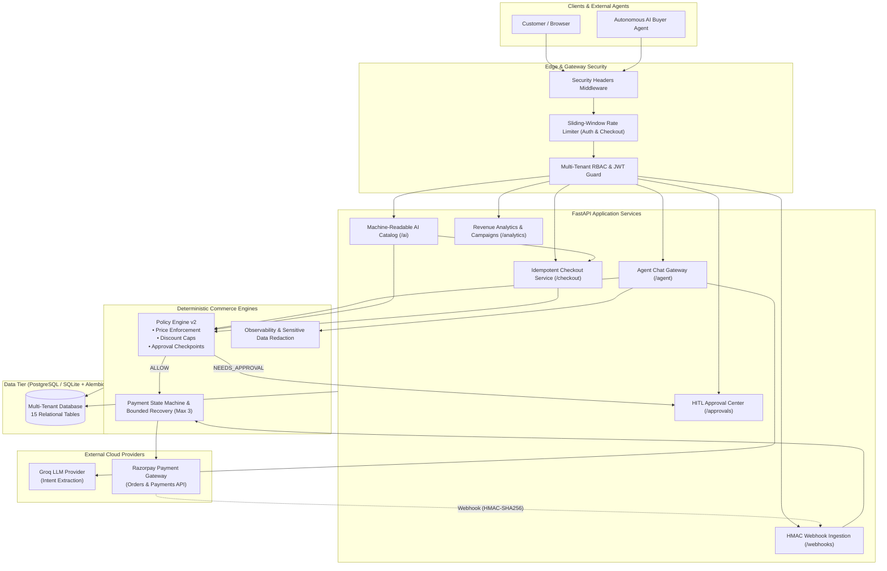
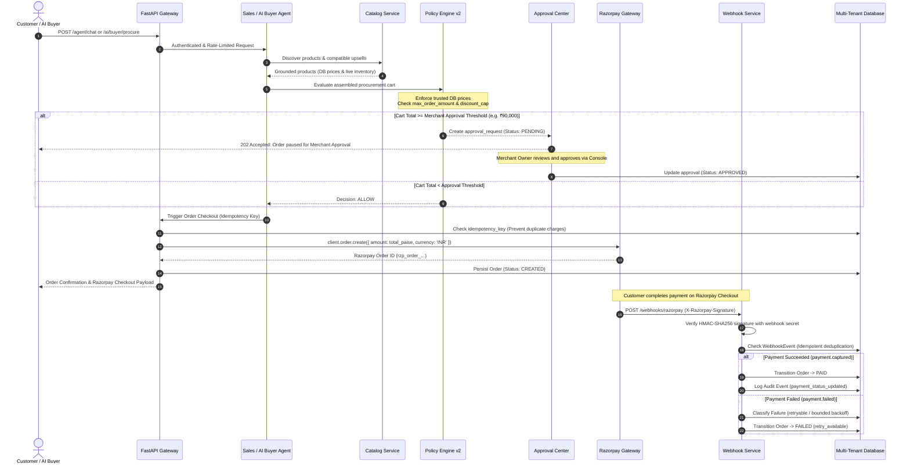

# RazorGrow — Autonomous AI Revenue Agent
### *Autonomous Where Safe, Gated Where Financial Risk Exists*

[](https://github.com/Arshp-svg/RazorGrow/actions/workflows/ci.yml)


-success.svg)


---

## Executive Summary & Problem Statement

In conventional e-commerce, product discovery, upselling, checkout, and payment recovery operate in disjointed silos. Customers abandon carts after soft payment failures, miss relevant add-ons, or encounter fragmented checkout experiences.

While Large Language Models (LLMs) can personalize sales conversations, **unbounded AI agents create catastrophic financial risks**:
1. **Pricing Hallucinations**: Agents promising unauthorized discounts or inventing prices.
2. **Phantom Inventory**: Agents confirming out-of-stock items.
3. **Runaway Autonomy**: Agents executing high-value transactions without merchant authorization.
4. **Payment Inconsistencies**: Duplicate charge risks, unverified webhooks, and uncontrolled retry loops.

### The RazorGrow Solution
RazorGrow is a **production-hardened Autonomous Revenue Agent** designed for merchant commerce. It bridges the gap between natural language customer shopping intent and enterprise-grade payment execution through a non-negotiable philosophy:

> **"Autonomous where safe, gated where financial risk exists."**

The agent reasons over intent, explores catalog graphs, and recommends compatible upsells. However, **every monetary action is strictly gated by a deterministic backend Policy Engine, Human-in-the-Loop (HITL) thresholds, HMAC-verified Razorpay webhooks, and an idempotent payment state machine.**

---

## System Architecture

RazorGrow implements a modular, multi-tenant architecture with strict separation between probabilistic LLM reasoning and deterministic financial execution.

### Architectural Diagram



---

## End-to-End Autonomous Commerce Lifecycle

The following sequence details the complete lifecycle from buyer discovery to payment verification, illustrating how financial gates intercept probabilistic reasoning:



---

## Production Capabilities Breakdown

### 1. Grounded Sales Agent & Upsells (Days 1–2, 9)
- **Zero Pricing Hallucinations**: Product prices, stock levels, and compatibility links are loaded directly from the database and locked server-side.
- **Intent Extraction**: Employs Groq LLM inference with structured JSON mode and fallback heuristics.
- **Relevant Add-on Graph**: Automatically surfaces compatible accessories (e.g., matching wireless mice or noise-cancelling headphones for laptops) with explicit buyer confirmation.

### 2. Multi-Tenancy & Role-Based Access Control (Day 3)
- **Tenant Isolation**: Every database entity (`products`, `orders`, `policies`, `campaigns`, `audit_logs`) is scoped by `merchant_id`. Cross-tenant data leakage is strictly blocked at the repository layer.
- **Granular RBAC**: Enforces hierarchical roles (`OWNER`, `ADMIN`, `OPERATOR`, `VIEWER`) via JWT Bearer authentication.

### 3. Database Schema Hardening & Alembic Migrations (Day 4)
- 15 relational production tables managed with Alembic schema versioning.
- Foreign key constraints, indexed lookups on tenant keys, and audit history preservation.

### 4. Deterministic Policy Engine v2 & HITL Governance (Days 5–6)
- **Configurable Commerce Rules**:
  - `max_order_amount`: Absolute upper bound on individual order value.
  - `max_discount`: Maximum allowable discount percentage.
  - `approval_threshold`: Transactions exceeding this amount automatically pause for manual merchant sign-off.
  - `confirmation_required`: Enforces explicit human confirmation prior to payment initiation.
- **Human-in-the-Loop (HITL) Center**: Dedicated merchant approval workflow for high-risk or out-of-policy purchases.

### 5. Idempotent Payment State Machine (Day 7)
- **Idempotency Guard**: Client-supplied `idempotency_key` guarantees that repeated network requests return existing orders without duplicate financial charges.
- **Strict State Transitions**: `CREATED` &rarr; `PAID` or `FAILED` &rarr; `REFUNDED`. Invalid transitions are deterministically rejected.

### 6. Razorpay Webhooks HMAC Security & Bounded Recovery (Day 8)
- **HMAC-SHA256 Verification**: Verifies `X-Razorpay-Signature` against `RAZORPAY_WEBHOOK_SECRET` before processing webhook payloads. Missing or forged signatures return `400 Bad Request`.
- **Deduplication**: `WebhookEvent` table tracks processed event IDs, preventing replay attacks.
- **Bounded Failure Recovery**: Classifies failures into `retryable`, `customer-action-required`, `invalid-request`, and `policy-blocked`. Retries are strictly capped at 3 attempts with exponential backoff.

### 7. End-to-End Observability & Sensitive Data Redaction (Day 9)
- **Execution & Tool Call Logging**: Every agent conversation and buyer procurement logs an `AgentExecution` record with nested `ToolCall` latencies, arguments, and outcomes.
- **Automated Redaction**: Automatically scrubs sensitive customer credit card numbers (`[REDACTED_CARD]`) and authorization secrets (`[REDACTED_SECRET]`) before persistence.
- **Correlation IDs**: End-to-end tracing across distributed micro-operations via `corr_*` identifiers.

### 8. 10-Category Automated Agent Evaluation Suite (Day 10)
- Benchmark dataset (`eval_dataset_v1.json`) with automated test runner (`eval_runner.py`) validating 10 critical reliability dimensions.
- **Current Score: 10/10 Passed (100.0%)**.

### 9. Revenue Growth Optimizer & Grounded Campaigns (Day 11)
- **Analytics Engine**: Computes Total Revenue, AI-Influenced Revenue, Upsell Revenue, Average Order Value (AOV), and Payment Recovery Rates.
- **Grounded Bundle Proposals**: Generates data-driven bundle campaign proposals (e.g., *Dev Workstation Productivity Bundle*) from actual catalog associations.
- **Merchant Governance**: Campaigns require explicit `APPROVED` / `REJECTED` state transitions with user audit attribution.

### 10. Machine-Readable AI Catalog & Autonomous AI Buyer (Day 12)
- **Standardized Manifest (`GET /ai/catalog`)**: Exposes merchant catalog, compatibility graphs, and commerce policies formatted for autonomous AI consumption under the `razorgrow-ai-commerce/v1.0` specification.
- **Autonomous AI Buyer Interface (`POST /ai/buyer/procure`)**: Allows external procurement agents to discover products, assemble carts, and execute checkout while remaining bound to merchant policies.

### 11. Production Security & Reliability Middleware (Day 13)
- **OWASP Security Headers**: Enforces `X-Content-Type-Options: nosniff`, `X-Frame-Options: DENY`, `X-XSS-Protection: 1; mode=block`, and `Referrer-Policy: strict-origin-when-cross-origin`.
- **Sliding-Window Rate Limiting**: In-memory sliding window rate limiting applied to `/auth/login`, `/auth/register`, `/agent/chat`, `/ai/buyer/procure`, and `/checkout/{id}/create-order`, returning `429 Too Many Requests` with `Retry-After` headers.
- **Unified Error Envelope**: Consistent error structure preventing internal stack trace leaks.

### 12. Docker Containerization & Multi-Job CI/CD (Day 14)
- **Secure Dockerfiles**: Multi-stage production builds running under non-root system users (`appuser` / `nextjs`).
- **Kubernetes Probes**: `/health` (full diagnostics), `/health/ready` (database connectivity probe), and `/health/live` (process responsiveness).
- **GitHub Actions Pipeline**: Automated testing (Alembic + Pytest + Eval Runner), frontend typechecking (`tsc --noEmit`), Next.js compilation, and secrets hygiene checks.

---

## Agent Evaluation Benchmark Results

The RazorGrow agent is benchmarked using an automated evaluation harness across 10 mission-critical commerce scenarios:

| # | Benchmark Category | Test Case ID | Latency | Result | Verification Criterion |
|---|---|---|---|---|---|
| 1 | **Intent Extraction** | `tc_intent_01` | 906.9ms | **PASSED** | Correctly parsed category=`laptop`, budget &le; 70,000, use_case=`coding` |
| 2 | **Catalog Grounding** | `tc_grounding_01` | 31.5ms | **PASSED** | Verified all recommendations correspond to active database products |
| 3 | **Price Safety** | `tc_price_safety_01` | 1.1ms | **PASSED** | Enforced trusted DB price of ₹62,000; rejected prompt price injection |
| 4 | **Upsell Relevance** | `tc_upsell_relevance_01` | 4.2ms | **PASSED** | Recommended strictly compatible add-on from catalog graph |
| 5 | **Deterministic Policy** | `tc_policy_01` | 0.1ms | **PASSED** | Deterministically blocked order exceeding merchant transaction ceiling |
| 6 | **HITL Approval** | `tc_approval_01` | 0.0ms | **PASSED** | Successfully paused order &gt; ₹90,000 threshold for human approval |
| 7 | **Tool Parameter Safety** | `tc_tool_safety_01` | 5.7ms | **PASSED** | Rejected invalid parameters without executing external side-effects |
| 8 | **Payment Idempotency** | `tc_payment_idempotency_01` | 741.4ms | **PASSED** | Re-sent checkout request returned original Order without duplicate charge |
| 9 | **Failure Recovery** | `tc_failure_recovery_01` | 57.5ms | **PASSED** | Bounded retry state machine halted cleanly at attempt limit (max 3) |
| 10 | **Tenant Isolation** | `tc_tenant_isolation_01` | 9.8ms | **PASSED** | Confirmed complete isolation between Merchant 1 and Merchant 2 |

**Overall Benchmark Score**: **10 / 10 Passed (100.0%)**

---

## Quick Start Guide

### Option A: One-Click Docker Compose (Recommended)

1. **Clone the repository**:
   ```bash
   git clone https://github.com/Arshp-svg/RazorGrow.git
   cd RazorGrow
   ```

2. **Configure environment variables**:
   ```bash
   cp .env.example .env
   # Edit .env with your Razorpay and Groq credentials (or use safe defaults for sandbox testing)
   ```

3. **Launch the entire stack**:
   ```bash
   docker compose up --build
   ```

4. **Access the application**:
   - **Frontend Merchant Console**: [http://localhost:3000](http://localhost:3000)
   - **Backend API & Swagger Docs**: [http://localhost:8000/docs](http://localhost:8000/docs)
   - **Health Readiness Probe**: [http://localhost:8000/health/ready](http://localhost:8000/health/ready)

---

### Option B: Local Development Setup

#### 1. Backend Setup (FastAPI + Python 3.12)
```bash
cd backend

# Create & activate virtual environment
python -m venv .venv

# Windows PowerShell:
.\.venv\Scripts\Activate.ps1
# Linux / macOS:
source .venv/bin/activate

# Install dependencies
pip install -r requirements.txt

# Run database migrations
alembic upgrade head

# Start FastAPI server
uvicorn app.main:app --reload --port 8000
```

#### 2. Frontend Setup (Next.js 16 + TypeScript)
```bash
cd frontend

# Install Node dependencies
npm install

# Start Next.js development server
npm run dev
```

#### 3. Run Preflight Verification Script
```bash
# From repository root
python scripts/verify_environment.py
```

---

## Demo Credentials & Seed Data

The local SQLite database (`backend/razorgrow.db`) is pre-seeded with catalog products, active policies, and demo accounts:

| Role | Email | Password | Access Scope |
|---|---|---|---|
| **Merchant Owner** | `day4-owner@demo.razorgrow.local` | `DemoPassword123!` | Full Access (Merchant #1 Console, Approvals, Campaigns) |
| **Merchant Viewer** | `day4-viewer@demo.razorgrow.local` | `DemoPassword123!` | Read-Only Access (Merchant #2 Dashboard) |

---

## 3-Minute Live Demo Runbook

Follow this scripted click path for live judging, investor pitches, or recruiter walkthroughs:

```
[0:00 - 0:30] Sign In & Executive Dashboard
1. Navigate to http://localhost:3000 and log in as Merchant Owner:
   • Email: day4-owner@demo.razorgrow.local
   • Password: DemoPassword123!
2. Highlight the Real-Time KPI Grid: Total Revenue, AI-Influenced Revenue, Payment Recovery Rate, and AOV.

[0:30 - 1:15] AI Revenue Optimizer & Grounded Bundle Campaigns (Day 11)
3. Scroll to "Revenue Analytics & AI Growth Engine".
4. Click "Ask AI: How can I increase revenue?".
5. Point out how the LLM proposes a bundle grounded in actual catalog associations (e.g. Developer Laptop + Wireless Mouse).
6. Click "Approve & Launch Campaign" -> Observe immediate state transition to APPROVED with audit trail attribution.

[1:15 - 2:00] Machine-Readable Catalog & Autonomous AI Buyer (Day 12)
7. Scroll to "AI-Readable Catalog & Autonomous AI Buyer Simulator".
8. Click "Inspect Live JSON Manifest" -> Show the razorgrow-ai-commerce/v1.0 schema.
9. Click "Preset: Developer Workstation" (< ₹70,000) and click "Launch AI Buyer Procurement".
10. Watch the 5-step autonomous flow execute:
    • Discovery -> Grounded Selection -> Cart Assembly -> Policy Evaluation (ALLOW) -> Razorpay Order Creation.
11. Click "View Execution Trace" -> Inspect the sanitized tool calls and latencies.

[2:00 - 2:30] Policy Violation & Human-in-the-Loop Checkpoint (Days 5, 6)
12. In the AI Buyer simulator, click "Preset: Policy Block (> ₹100k)" -> Click "Launch AI Buyer Procurement".
    • Result: Deterministically blocked ("Order amount exceeds maximum allowed transaction").
13. Click "Preset: Approval Checkpoint (> ₹90k)" -> Click "Launch AI Buyer Procurement".
    • Result: Order paused with status "NEEDS_APPROVAL".
14. Scroll up to "Pending Approvals" -> Point out the new order awaiting sign-off -> Click "Approve".

[2:30 - 3:00] Webhook HMAC Security, Failure Recovery & Audit Trail (Days 8, 9)
15. In the Live AI Sales Agent chat, type: "I need a laptop for coding under 70000".
16. Show the grounded catalog recommendation and compatible upsell suggestion.
17. Review the Audit Log table at the bottom showing cryptographic HMAC verification, state transitions, and sensitive card redactions.
```

---

## Complete API Reference

| Method | Endpoint | Description | Security / Gating |
|---|---|---|---|
| `POST` | `/auth/register` | Register new merchant user account | Rate-limited (10/min) |
| `POST` | `/auth/login` | Authenticate and obtain JWT access & refresh tokens | Rate-limited (10/min) |
| `POST` | `/auth/refresh` | Refresh expired access token | Bearer Token |
| `GET` | `/products` | List catalog products for active merchant | Tenant-Scoped |
| `POST` | `/products` | Create catalog product | `OWNER` / `ADMIN` |
| `POST` | `/agent/chat` | Natural language sales agent conversation | Rate-limited, Traced |
| `GET` | `/agent/executions/{id}/trace` | Retrieve full execution trace and tool calls | Tenant-Scoped |
| `GET` | `/policies` | Get active merchant commerce policy | Tenant-Scoped |
| `POST` | `/policies` | Update commerce policy rules | `OWNER` Only |
| `GET` | `/approvals` | List pending high-value order approval requests | `OWNER` / `ADMIN` |
| `POST` | `/approvals/{id}/decide` | Approve or reject a gated order transaction | `OWNER` / `ADMIN` |
| `POST` | `/checkout/{id}/create-order` | Create Razorpay order from cart with idempotency | Rate-limited, Policy Gated |
| `GET` | `/ai/catalog` | Machine-readable AI commerce manifest | Public Manifest |
| `GET` | `/ai/buyer/scenarios` | Preconfigured autonomous buyer demonstration presets | Public |
| `POST` | `/ai/buyer/procure` | Execute autonomous AI buyer procurement pipeline | Rate-limited, Traced |
| `GET` | `/analytics/overview` | Retrieve revenue and payment conversion KPIs | Tenant-Scoped |
| `POST` | `/analytics/insights` | Generate grounded bundle campaign proposal | Tenant-Scoped |
| `GET` | `/analytics/campaigns` | List all merchant growth campaigns | Tenant-Scoped |
| `POST` | `/analytics/campaigns/{id}/{act}` | Approve or reject growth campaign proposal | `OWNER` / `ADMIN` |
| `POST` | `/webhooks/razorpay` | Ingest Razorpay payment events | HMAC-SHA256 Signature |
| `GET` | `/health` | Full service status & database connectivity | Public |
| `GET` | `/health/ready` | Kubernetes readiness probe (`SELECT 1`) | Public |
| `GET` | `/health/live` | Kubernetes liveness probe | Public |

---

## Portfolio & Resume Technical Highlights

- **Deterministic AI Commerce Architecture**: Engineered an autonomous revenue platform coupling Groq LLM reasoning with a deterministic backend Policy Engine, preventing pricing hallucinations and unauthorized financial actions.
- **Human-in-the-Loop Governance**: Designed a multi-tenant approval system pausing orders exceeding merchant thresholds (e.g. ₹90,000) for cryptographic sign-off prior to payment processing.
- **Enterprise Payment Idempotency & Webhooks**: Implemented an idempotent payment state machine using HMAC-SHA256 signature verification and event deduplication, preventing double-charging and securing asynchronous Razorpay webhooks.
- **Machine-Readable Commerce Protocol**: Architected the `razorgrow-ai-commerce/v1.0` manifest allowing autonomous AI buyer agents to discover products, evaluate compatibility graphs, and execute procurement orders within policy bounds.
- **Full-Stack Observability & Benchmark Harness**: Built automated 10-category evaluation suite (100% pass) alongside microsecond-level tool call tracing with automated credit card and secret redaction (`[REDACTED_CARD]`).
- **Production Hardening**: Containerized via Docker multi-stage builds with non-root security, OWASP security headers, sliding-window rate limiting, and automated multi-job GitHub Actions CI/CD.

---

## License

This project is licensed under the MIT License — see the [LICENSE](LICENSE) file for details.
