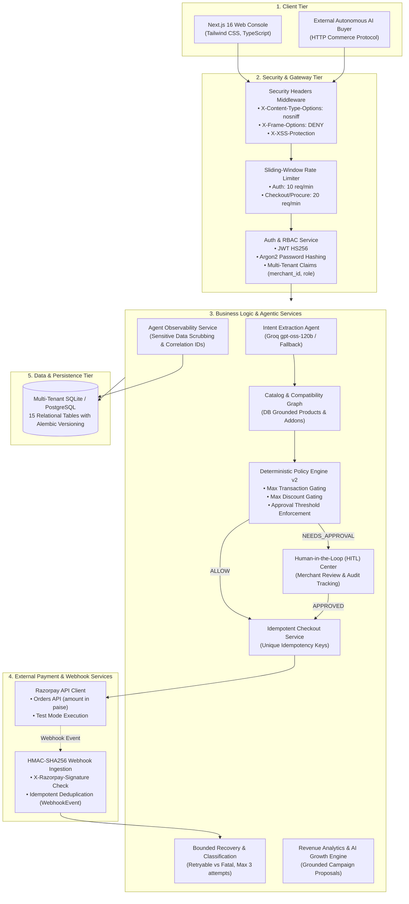

# RazorGrow System Architecture & Technical Specifications

This document outlines the detailed technical architecture, component interactions, safety barriers, and data schemas of **RazorGrow** — an Autonomous AI Revenue Agent for merchant commerce.

---

## 1. Architectural Philosophy

Traditional AI commerce bots are often given free-form tool-calling privileges or allowed to construct orders directly from prompt text. In production financial systems, this introduces catastrophic risks:
- Pricing hallucinations
- Inventory mismatches
- Unauthorized discount codes
- Duplicate payment charges

RazorGrow solves this with a strict architectural boundary:

> **"Probabilistic reasoning for intent and discovery; deterministic engines for inventory, pricing, and money."**

---

## 2. Component Architecture

---

## 3. Data Tier: 15 Relational Production Tables

The schema is hardened with foreign key constraints, tenant scoping (`merchant_id`), indexes, and Alembic versioning:

1. **`merchants`**: Tenant master entity with status and settings.
2. **`users`**: System users with Argon2 password hashes and active status.
3. **`merchant_memberships`**: Associates users with merchants with RBAC roles (`OWNER`, `ADMIN`, `OPERATOR`, `VIEWER`).
4. **`products`**: Grounded inventory containing prices, categories, tags, use cases, compatibility lists, and upsell associations.
5. **`carts`**: Active customer shopping carts.
6. **`cart_items`**: Line items linked to trusted database products.
7. **`orders`**: Orders persisted with status (`CREATED`, `PAID`, `FAILED`, `REFUNDED`), amounts in paise, and unique idempotency keys.
8. **`policies`**: Merchant commerce policies defining `max_order_amount`, `max_discount`, `approval_threshold`, and version numbers.
9. **`approval_requests`**: Gated transactions paused for merchant sign-off (`PENDING`, `APPROVED`, `REJECTED`).
10. **`webhook_events`**: Deduplicated record of ingested Razorpay webhooks to prevent replay attacks.
11. **`refresh_tokens`**: Revocable JWT session tokens.
12. **`agent_executions`**: Top-level trace records tracking agent conversations and procurement sessions.
13. **`tool_calls`**: Microsecond-level tool execution logs with sensitive data scrubbing.
14. **`audit_logs`**: Immutable compliance audit trail tracking all monetary and governance decisions.
15. **`campaigns`**: Grounded AI growth proposals with structured bundle configurations and merchant decision history.

---

## 4. Security & Safety Model

### 1. Data Redaction in Traces
All tool call arguments and responses pass through `sanitize_data()` before logging:
- Credit card numbers matching Luhn-valid patterns are replaced with `[REDACTED_CARD]`.
- API keys, JWTs, and bearer tokens are replaced with `[REDACTED_SECRET]`.

### 2. Webhook Cryptographic Verification
Webhooks from Razorpay must include an `X-Razorpay-Signature` header. The backend computes:
$$\text{Expected Signature} = \text{HMAC-SHA256}(\text{raw\_body}, \text{RAZORPAY\_WEBHOOK\_SECRET})$$
Any mismatch terminates immediately with an HTTP `400 Bad Request` and logs an audit security event.

### 3. Payment Idempotency
Every checkout invocation requires a client-provided `idempotency_key`. The checkout service checks whether an order with this key already exists for the merchant. If found, the existing order record and Razorpay payload are safely returned without creating a duplicate payment request.

### 4. Sliding-Window Rate Limiting
To defend against brute-force attacks and denial-of-service, endpoints are shielded with in-memory sliding window rate limits:
- Authentication (`/auth/login`, `/auth/register`): 10 requests / 60 seconds
- Agent Chat & AI Buyer (`/agent/chat`, `/ai/buyer/procure`): 20 requests / 60 seconds
- Checkout Order Creation (`/checkout/{id}/create-order`): 20 requests / 60 seconds
Excess requests are rejected with `429 Too Many Requests` including standard `Retry-After` headers.